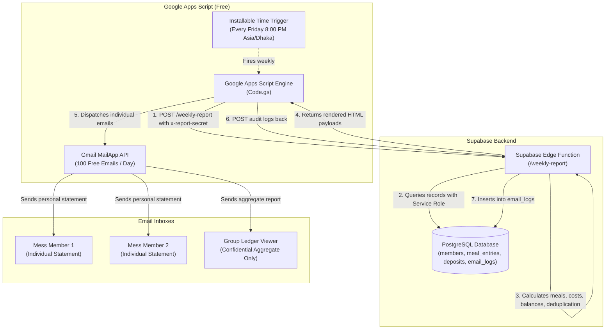

# Free Gmail-Based Weekly Email Reporting Setup Guide
**Mill Management System (মিল ম্যানেজমেন্ট সিস্টেম)**

This guide walks you step-by-step through setting up, testing, and managing the automated weekly email reporting system using **Google Apps Script** and **Supabase Edge Functions**.

---

## 🏗️ Architecture Overview



### Key Guarantees:
1. **100% Free Forever:** Uses Google Apps Script's built-in `MailApp` quota (up to 100 emails/day for free `@gmail.com` accounts). No domain registration, DNS records, or paid email APIs (Resend/SendGrid) required.
2. **Complete Credential Isolation:** Frontend web code **never** sees the `REPORT_SHARED_SECRET` or Supabase `service_role` key.
3. **Strict Privacy for Group Ledger Viewer:** The viewer receives **only aggregate metrics** (total meals, total meal expenses, total collected funds, treasury balance). Individual names, meal tallies, and member balances are 100% excluded.
4. **Duplicate-Send Prevention:** Automatically tracks every successful dispatch in `public.email_logs`. If a trigger runs multiple times in the same weekly cycle, duplicate emails are suppressed.
5. **Safety Switch (Requirement 10):** Automatic sending is locked to `FALSE` by default until you test and explicitly approve activation.

---

## 📋 Step 1: Run Supabase SQL Migration

1. Open your Supabase Dashboard SQL Editor:
   [https://supabase.com/dashboard/project/hnmvuopdpubdlsveojrq/sql](https://supabase.com/dashboard/project/hnmvuopdpubdlsveojrq/sql)
2. Click **New query**.
3. Open [`supabase/migrations/003_weekly_email_reporting.sql`](../supabase/migrations/003_weekly_email_reporting.sql) and paste the entire script:
   - Adds `email` to `public.members`.
   - Adds `group_ledger_viewer_email` to `public.settings`.
   - Creates `public.email_logs` table with indexes and RLS.
4. Click **Run** (or press `Ctrl+Enter`).
5. Confirm that the query succeeds with `Success. No rows returned`.

---

## ⚡ Step 2: Deploy the Supabase Edge Function

The Edge Function code is located at:
[`supabase/functions/weekly-report/index.ts`](../supabase/functions/weekly-report/index.ts)

### Option A: Deploy via Supabase Dashboard (Recommended - Quickest)
1. Go to your Supabase project: **Edge Functions**:
   [https://supabase.com/dashboard/project/hnmvuopdpubdlsveojrq/functions](https://supabase.com/dashboard/project/hnmvuopdpubdlsveojrq/functions)
2. Click **New Function** (or **Create Function**).
3. Set the function name to: `weekly-report`.
4. Copy the entire contents of [`supabase/functions/weekly-report/index.ts`](../supabase/functions/weekly-report/index.ts) and paste it into the editor.
5. Click **Deploy**.

### Option B: Deploy via Supabase CLI
If you have Supabase CLI:
```bash
npx supabase functions deploy weekly-report --no-verify-jwt
```

### Configure Edge Function Secret:
1. In the Supabase Dashboard, go to **Edge Functions** > **Manage Secrets** (or **Project Settings** > **Edge Functions**).
2. Add a new secret:
   - **Name:** `REPORT_SHARED_SECRET`
   - **Value:** Choose a strong random string (e.g., generate a 32-character random string like `mill_sec_8923fd74a81bc20e98124`).
   *(Save this secret string; you will need it in Step 4).*

Your Edge Function endpoint URL is:
```text
https://hnmvuopdpubdlsveojrq.supabase.co/functions/v1/hyper-action
```

---

## 📜 Step 3: Copy Code into Google Apps Script

1. Open your Apps Script project in your browser:
   [https://script.google.com/home/projects/1LU-TD3RUOzjj_gAejYDlo6ZNoJN2XAJNXdMmZ7VEXVZce_juFao-E853/edit](https://script.google.com/home/projects/1LU-TD3RUOzjj_gAejYDlo6ZNoJN2XAJNXdMmZ7VEXVZce_juFao-E853/edit)
2. In the left file tree, click on `Code.gs`.
3. Select all existing text and delete it.
4. Copy the entire content from [`gas/Code.gs`](../gas/Code.gs) and paste it into `Code.gs`.
5. Press `Ctrl+S` (or click the disk icon) to save.

*(Optional - Set Timezone)*:
- Click the gear icon (**Project Settings**) in the left sidebar.
- Check the box: **Show "appsscript.json" manifest file in editor**.
- Go back to the **Editor** (`< >` icon), click `appsscript.json`, and ensure `"timeZone": "Asia/Dhaka"` is set as in [`gas/appsscript.json`](../gas/appsscript.json).

---

## 🔐 Step 4: Configure Script Properties

In Google Apps Script, secrets must **never** be hardcoded in the script file. Store them safely in **Script Properties**:

1. In your Apps Script editor, click the gear icon ⚙️ (**Project Settings**) in the left sidebar.
2. Scroll down to the **Script Properties** section.
3. Click **Add script property** for each of the following:

| Property Name | Example / Expected Value | Description |
| :--- | :--- | :--- |
| `SUPABASE_FUNCTION_URL` | `https://hnmvuopdpubdlsveojrq.supabase.co/functions/v1/hyper-action` | The URL of your deployed Supabase Edge Function |
| `REPORT_SHARED_SECRET` | `your_chosen_secret_here` | The exact same secret string you configured in Step 2 |
| `ADMIN_TEST_EMAIL` | `yourgmail@gmail.com` | Your administrator Gmail address for receiving test previews |

4. Click **Save script properties**.

---

## 🔑 Step 5: Authorize Gmail Permissions

Google Apps Script requires one-time OAuth authorization to use Gmail (`MailApp`):

1. Switch back to the Apps Script **Editor** (`< >`).
2. In the top toolbar function dropdown, select **`verifyConfiguration`**.
3. Click **Run**.
4. An **"Authorization required"** dialog will pop up:
   - Click **Review permissions**.
   - Choose your Google Account.
   - Click **Advanced** (at the bottom).
   - Click **Go to Untitled project (unsafe)** (Google shows this warning because this is your own private unverified script).
   - Click **Allow**.
5. Look at the **Execution log** at the bottom of the screen. You should see:
   ```text
   ✅ SUPABASE_FUNCTION_URL: https://...
   ✅ REPORT_SHARED_SECRET: Configured (length: 32 chars)
   ✅ ADMIN_TEST_EMAIL: yourgmail@gmail.com
   ✅ Gmail Sending Quota Remaining: 100 emails/day
   ✅ Configuration verification PASSED.
   ```

---

## 🧪 Step 6: Safe Testing Procedure

Follow this safe sequence before enabling any automated schedules:

### Test 1: Send Sample Preview to Admin Only (Zero Member Disturbance)
1. In the Apps Script toolbar function dropdown, select **`sendTestEmail`**.
2. Click **Run**.
3. Apps Script will request preview reports from the Edge Function and email them **only to your `ADMIN_TEST_EMAIL`**.
4. Open your Gmail inbox (and check Spam / Updates tab just in case):
   - You will receive 2 emails:
     1. **`[TEST] Mill Weekly Report Preview (...)`**: Individual member statement layout with green/rose balance badges, daily lunch/dinner rows, and lifetime reconciliation.
     2. **`[TEST] Mill Weekly Group Aggregate Ledger (...)`**: Confidential group audit report with group treasury balance, weekly totals, and zero individual member names.
5. Verify on both your mobile device and desktop that the layout renders cleanly.

### Test 2: Add Real Member Emails in Mill Manager App
1. Open the Mill Management web application (`http://localhost:3000/members` or production).
2. Click the edit icon (✏️) beside each member (Tuhin, Rahim, Karim, Hasan).
3. Enter their respective email addresses and click **Save Changes**.
4. Go to **Settings** (`/settings`):
   - Under **Group Ledger Viewer Recipient Email**, enter the viewer's email (or leave blank if no third-party viewer exists yet).
   - Click **Save Configuration**.

### Test 3: Manual Full Send Test
1. In Apps Script, select **`sendWeeklyReportsManually`**.
2. Click **Run**.
3. In the Execution log, observe:
   - Reports generated for all members who have emails.
   - Group Ledger Viewer report generated if configured.
   - Successful dispatch to each recipient.
   - Audit logs posted back to Supabase.
4. Run `sendWeeklyReportsManually` a second time:
   - Notice that the log outputs: `[SKIPPED - DUPLICATE] ... was already sent for this period.`
   - This proves that duplicate-send prevention is working 100%!

### Test 4: Verify Database Audit Logs
1. In Supabase Dashboard, open **Table Editor** > **`email_logs`**.
2. You will see rows with:
   - `report_period_start`, `report_period_end`
   - `recipient_email`, `status: "sent"`
   - `sent_at` timestamp

---

## ⏰ Step 7: Automatic Trigger Setup (Friday Evening Asia/Dhaka)

> [!IMPORTANT]
> **Safety Notice (Requirement 10):**
> Automatic sending is locked to `false` by default. Do not perform this step until you have reviewed the test emails and are completely ready for automatic Friday dispatches.

When you are ready to activate:

1. In `Code.gs`, change line 31:
   ```javascript
   // Change from false to true:
   var AUTOMATIC_SENDING_ENABLED = true;
   ```
2. Press `Ctrl+S` to save `Code.gs`.
3. In the toolbar function dropdown, select **`setupWeeklyTrigger`**.
4. Click **Run**.
5. The script will automatically schedule an installable time-driven trigger for **every Friday at 20:00 (8:00 PM) Asia/Dhaka time**.
6. To inspect your active triggers at any time:
   - Click the clock icon ⏰ (**Triggers**) in the left sidebar of Apps Script.
   - You will see `sendWeeklyReports` set to **Time-driven > Week timer > Every Friday 8pm to 9pm**.

To disable automatic sending at any time:
- In the function dropdown, select **`removeWeeklyTrigger`** and click **Run**, or change `AUTOMATIC_SENDING_ENABLED = false;`.

---

## 🛡️ Security Summary

- **Supabase Service Role Key:** Stored inside the Supabase Edge Function environment only; never transmitted to Google Apps Script or browser clients.
- **Report Shared Secret (`REPORT_SHARED_SECRET`):** Known only to the Edge Function and Apps Script `Script Properties`; never hardcoded in Git.
- **Gmail Account Security:** Dispatches directly through your authenticated Google session (`MailApp`), eliminating the need for third-party SMTP relay credentials or app passwords.
- **Member Privacy:** The Group Ledger Viewer template strictly redacts individual identities, member tallies, and private balances.
